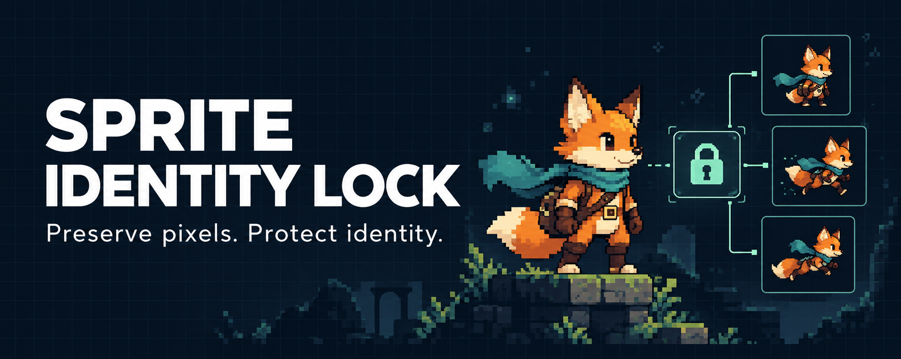
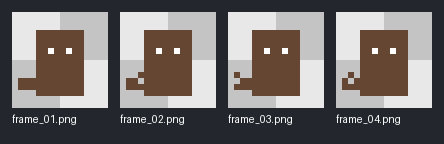
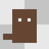
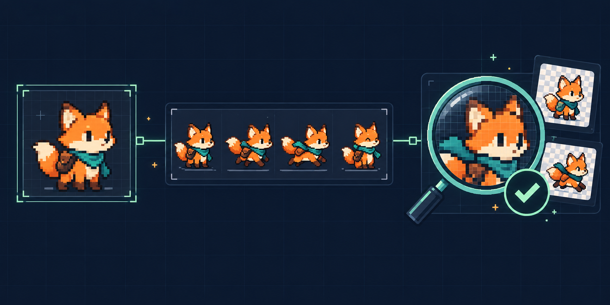

<div align="center">



# Sprite Identity Lock

**O mesmo personagem. Quadro após quadro.**

Skill para preservar a identidade visual de personagens em pixel art, com contrato visual, auditoria de pixels e previews para revisão.

[](https://github.com/playertwo1/sprite-identity-lock/actions/workflows/tests.yml)


[](SKILL.md)

[Começar](#comece-em-poucos-comandos) · [Instalar a skill](#instale-no-seu-agente) · [Demonstração](#veja-uma-auditoria-real) · [Contrato](#defina-o-contrato-do-personagem) · [Limites](#o-que-o-resultado-significa)

</div>

---

Um piscar não deveria trocar o rosto. Uma corrida não deveria mudar a roupa. **Sprite Identity Lock** ajuda a transformar essas expectativas em um processo verificável: escolher um mestre aprovado, delimitar o que pode mudar, produzir os frames e revisar a sequência antes de integrar no jogo.

A skill reúne instruções para o agente e ferramentas Python independentes. A auditoria funciona offline com Pillow; geração e edição dependem das ferramentas disponíveis no ambiente.

> [!IMPORTANT]
> `PASS` significa que as verificações implementadas passaram. Identidade, anatomia e fluidez ainda exigem inspeção visual. A skill não torna um gerador de imagens determinístico.

## O que vem no pacote

| Recurso | Para que serve |
| --- | --- |
| [SKILL.md](SKILL.md) | Fluxo operacional, escolha de modo e critérios de revisão. |
| [Auditor](scripts/sprite_audit.py) | Confere dimensões, paleta, mestre, regiões fixas e possíveis inconsistências. |
| [Recortador](scripts/split_sheet.py) | Separa grades regulares sem interpolar nem redimensionar. |
| [Character DNA](references/character-dna.md) | Explica o contrato visual e cada verificação. |
| [Prompts](references/prompts.md) | Modelos para gerar por referência ou reparar quadros. |
| [Manifesto de exemplo](assets/character-lock.example.json) | Ponto de partida para seu personagem. |
| [Exemplo executável](examples/minimal) | Mestre, manifesto, quatro frames e spritesheet para experimentar. |
| [Testes](tests/test_sprite_audit.py) | Regressões para os scripts; executados também no GitHub Actions. |

## Comece em poucos comandos

Você precisa de **Git, Python 3.10 ou superior e Pillow**. Não precisa de API de imagem para testar a auditoria. Os comandos abaixo partem da raiz do repositório.

```bash
git clone https://github.com/playertwo1/sprite-identity-lock.git
cd sprite-identity-lock
python -m venv .venv
```

Ative o ambiente conforme seu sistema:

| Sistema | Comando |
| --- | --- |
| Windows / PowerShell | `.venv\Scripts\Activate.ps1` |
| macOS / Linux | `source .venv/bin/activate` |

Se o PowerShell bloquear a ativação, use `.venv\Scripts\python.exe` no lugar de `python` nos comandos seguintes, sem mudar a política de execução.

```bash
python -m pip install -r requirements.txt
python scripts/sprite_audit.py --manifest examples/minimal/character-lock.json --frames-dir examples/minimal/frames --out-dir out/demo-audit --fps 6
```

O exemplo deve retornar `STATUS: PASS` e criar:

```text
out/demo-audit/
├── report.json          # Status, hashes, métricas, erros e avisos
├── contact_sheet.png    # Quadros lado a lado
└── preview.gif          # Sequência para inspeção
```

**Para repetir, escolha uma pasta de saída nova**, como `out/demo-audit-2`. A ferramenta recusa sobrescrever suas saídas.

## Veja uma auditoria real

<div align="center">

<br>

</div>

Esse exemplo geométrico vem da fixture de testes. Ele demonstra bloqueio de região e preservação de paleta; **não é uma animação gerada pelo ImageGen**. A capa e a ilustração abaixo são peças conceituais criadas com IA, não resultados auditados. Os [prompts estão documentados](docs/image-prompts.md).

## Instale no seu agente

A pasta instalada deve conter `SKILL.md`, `scripts`, `references` e `assets`. Copiar o repositório completo também preserva os testes e a documentação.

### Codex

No PowerShell, a partir da raiz do repositório:

```powershell
$skillDestination = Join-Path $env:USERPROFILE '.codex/skills/sprite-identity-lock'
if (Test-Path -LiteralPath $skillDestination) { throw 'A skill já existe. Compare e preserve a versão instalada antes de atualizar.' }
git clone https://github.com/playertwo1/sprite-identity-lock.git $skillDestination
```

Se você usa `CODEX_HOME` personalizado, use `<CODEX_HOME>/skills/sprite-identity-lock`. Reabra a sessão para atualizar a descoberta. Para invocar:

```text
$sprite-identity-lock
Revise estes quatro frames com o master aprovado. Preserve rosto e roupa,
permita somente o piscar e entregue relatório, contact sheet e preview.
```

### Antigravity

Para a organização local de skills usada neste projeto:

```powershell
$skillDestination = Join-Path $env:USERPROFILE '.gemini/antigravity/skills/sprite-identity-lock'
if (Test-Path -LiteralPath $skillDestination) { throw 'A skill já existe. Compare e preserve a versão instalada antes de atualizar.' }
git clone https://github.com/playertwo1/sprite-identity-lock.git $skillDestination
```

Reabra a sessão e peça para usar `sprite-identity-lock`. A descoberta depende da versão e da configuração do agente. Os scripts podem ser executados diretamente mesmo sem integração com um agente. Use o Python com Pillow instalado e caminhos absolutos para os scripts quando estiver trabalhando em outro projeto.

## Escolha o modo certo



| Modo | Quando usar | Regra principal |
| --- | --- | --- |
| **PIXEL_LOCK** | Piscar, respiração, cauda ou pequenos gestos. | Preserve as regiões imóveis e altere somente as partes autorizadas. |
| **REFERENCE_STRIP** | Andar, correr, pular ou poses maiores. | Use o mestre como referência visual e produza uma faixa coerente. |
| **REPAIR** | Frames existentes com identidade alterada. | Corrija apenas os quadros ou regiões afetados. |

**Fluxo:** mestre aprovado → contrato visual → produção ou reparo → auditoria → revisão visual → integração autorizada no motor. Consulte [SKILL.md](SKILL.md) para executar cada etapa e [os prompts](references/prompts.md) quando houver geração por imagem.

## Defina o contrato do personagem

Copie [character-lock.example.json](assets/character-lock.example.json) para seu projeto. Adapte dimensões, caminhos e regiões; as coordenadas do exemplo não são um padrão universal.

```json
{
  "character_id": "meu-personagem",
  "master_sprite": "master.png",
  "canvas": { "width": 64, "height": 64 },
  "palette": [],
  "palette_policy": "strict",
  "lock_first_frame": true,
  "fixed_regions": [
    { "name": "rosto_estatico", "rect": [20, 8, 24, 16], "max_changed_pixels": 0 }
  ]
}
```

- **Caminhos:** `master_sprite` é relativo ao arquivo do manifesto.
- **Paleta:** `[]` usa as cores do mestre; `strict` reprova cores extras e `review` pede revisão.
- **Regiões:** `[x, y, largura, altura]` usa coordenadas absolutas do quadro. Bloqueie somente partes que permanecem nessa posição.
- **Integridade:** o campo opcional `master_sha256` registra o hash do arquivo aprovado.
- **Exceções:** `region_exceptions` libera uma região por nome de frame; justifique cada liberação.
- **Tolerâncias:** são avisos, não correções automáticas. Uma razão de `0.30` equivale a 30%.

Campos desconhecidos e tipos inválidos são rejeitados. `identity_notes` e `allowed_changes` orientam a revisão; **não são máscaras executáveis**. O bloqueio espacial automático cobre somente `fixed_regions`. Veja o [contrato completo](references/character-dna.md).

### Já tem uma spritesheet?

```bash
python scripts/split_sheet.py --input minha-faixa.png --columns 4 --rows 1 --out-dir out/meus-frames
```

Use uma pasta nova ou vazia. A imagem precisa ser estática, divisível exatamente pela grade e sem gutters ou margens. O recorte segue da esquerda para a direita, de cima para baixo. Não altera a escala; nomes com zeros mantêm a ordem em sequências longas.

## O que o resultado significa

| Status | Interpretação | Próxima ação |
| --- | --- | --- |
| **PASS** | As verificações automáticas passaram. | Inspecione identidade, sequência e execução na engine. |
| **REVIEW** | Há avisos: alinhamento, semitransparência, duplicatas ou variação visual. | Decida se cada mudança é intencional. |
| **FAIL** | Alguma regra falhou ou um frame está inválido. | Repare a causa e audite novamente antes de publicar. |

O auditor verifica PNG estático, dimensões, transparência, paleta, primeiro frame opcional, regiões fixas e hash opcional do mestre. Também aponta mudanças na área ocupada, deslocamento da âncora calculada e frames repetidos. RGB oculto em pixels totalmente transparentes é ignorado nas comparações visuais.

> [!WARNING]
> O código de saída **0 inclui PASS e REVIEW**. O código **2 indica FAIL ou erro de entrada**. Em automações, leia `status` no JSON; saída 0 não autoriza publicar assets.

O relatório lista os arquivos em `preview_frames`. Frames inválidos podem ficar fora das imagens: nesse caso o preview é parcial. O JSON é gravado antes dos previews para preservar diagnósticos se a renderização falhar; confirme que todos os arquivos esperados foram criados.

GIF pode quantizar cores e tempo. Confira a paleta nos PNGs originais e o ritmo na engine. A âncora usa o centro inferior da área visível; não é o pivô cadastrado no motor. Para saltos ou partes que mudam de posição, uma região fixa no canvas pode ser inadequada.

## Testes e contribuição

```bash
python -m unittest discover -s tests -v
```

A suíte contém **16 testes**. O [GitHub Actions](.github/workflows/tests.yml) executa os testes e o exemplo documentado em Linux e Windows, com Python 3.10 e 3.12.

Encontrou um problema? [Abra uma issue](https://github.com/playertwo1/sprite-identity-lock/issues) com um caso mínimo. Para alterações, consulte [CONTRIBUTING.md](CONTRIBUTING.md).

## Estrutura

```text
sprite-identity-lock/
├── SKILL.md                  # Instruções do agente
├── requirements.txt          # Pillow >=10, <13
├── scripts/                  # Auditoria e recorte
├── references/               # Contrato visual e prompts
├── assets/                   # Manifesto editável
├── tests/                    # Testes de regressão
├── examples/minimal/         # Demonstração reproduzível
├── docs/                     # Imagens, prompts e referências da pesquisa
└── .github/workflows/         # Verificação automática
```

## Créditos e termos de uso

Mantido por [playertwo1](https://github.com/playertwo1). Esta é uma skill independente; não implica vínculo ou endosso dos produtos mencionados.

A apresentação foi orientada pela documentação do GitHub e por projetos populares como **build-your-own-x**, **awesome** e **Gum**. Consulte a [pesquisa com links e contagens de estrelas](docs/references.md). Nenhum texto, logo ou asset desses projetos foi copiado.

As duas ilustrações de apresentação foram criadas com ImageGen. As imagens de demonstração vêm dos testes locais e da saída dos scripts; os arquivos originais da skill e seus recursos estão incluídos neste repositório.

<!-- LICENSE_STATUS -->
Nenhuma licença de redistribuição foi adicionada nesta publicação. Consulte o mantenedor antes de reutilizar ou redistribuir o material.
<!-- /LICENSE_STATUS -->
